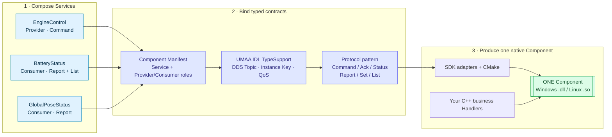
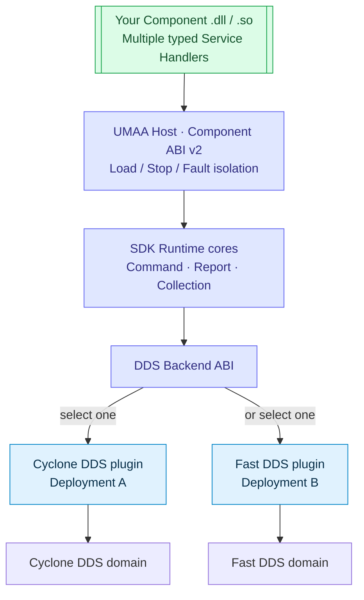
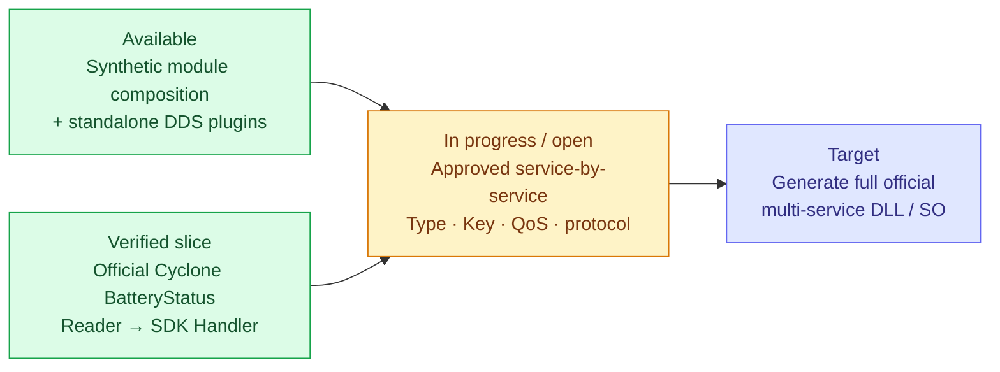

<div align="center">

# UMAA Kit


### One Component. Many Services. One DLL / SO.

**Compose typed UMAA services into a native C++ Component — without hand-writing every DDS Topic, protocol state machine, and lifecycle adapter.**

**C++17 · Windows DLL / Linux SO · CMake · Component ABI v2 · Cyclone DDS / Fast DDS**

[](https://github.com/rydolabs/umaa-kit/actions/workflows/ci.yml)
[](https://github.com/rydolabs/umaa-kit/actions/workflows/verifier.yml)

[See the architecture](#one-component-many-service-contracts) · [Run the CLI](#build-a-component) · [Current implementation](#what-is-real-today) · [Development status](#what-comes-next)

</div>

---

## One Component, many Service Contracts

A Component is **one deployable native module**. It can provide and consume multiple services. Each service connects **IDL types → DDS Topics / Keys / QoS → communication patterns**; the SDK takes responsibility for the protocol wiring so application developers can focus on business Handlers.



**Architecture goal, not a claim of complete official code generation:** the CLI already creates buildable **synthetic `Demo::`** modules. Official UMAA contracts are source-gated; the verified BatteryStatus Cyclone DDS implementation is currently a **selected, manually integrated slice**, not an automatically generated all-service module.

### Two ways to compose — one Manifest


The **CLI is usable today**. The planned **React Flow Studio** designer will edit that same Manifest and reuse the same generator — not create a separate, incompatible code path.

## The patterns live in the SDK

| Pattern | DDS contract and message flow | The SDK's responsibility |
|---|---|---|
| **Command** | Command → Status / Ack, Update, Cancel | Correlation, state transitions, timeouts, keyed lifecycle |
| **Report** | Typed Report Topic → subscribers | Source identity, typed delivery, update / Dispose |
| **Collection** | Report metadata + Set / List Elements | Keyed assembly, checkpoints, invalidation, bounded recovery |

The **Topic names, Types, Keys, roles and required QoS come from reviewed Service Contracts** — not guessed from service names. Unsupported mandatory semantics fail closed rather than being emulated as verified DDS behavior.

## Build once. Choose a standalone DDS backend.

The Component binary owns the user business logic. The Host loads it through Component ABI v2; the SDK's protocol and backend layers manage the transport. Cyclone DDS and Fast DDS are selected **in separate vendor-specific deployments**, with the same compiled application binaries in tested synthetic scenarios.



**Standalone backend substitution is tested; mixed Cyclone ↔ Fast DDS network interoperability is not.** RTI Connext is a future adapter, not a shipped backend.

## What is real today

| Available implementation | Scope |
|---|---|
| **Component CLI → native DLL / SO** | Multi-service Manifest, C++ Handler scaffolding, CMake build, ABI-v2 module loading and smoke tests for synthetic development services |
| **Protocol cores + DDS plugins** | Command / Report / Collection development paths; standalone Cyclone and Fast DDS real-wire tests and same-binary substitution |
| **Official source-backed contract evidence** | 53 curated six-ICD service candidates / 113 Topic identities; source-checked public Component role mentions: 51 Provider + 40 Consumer |
| **Official BatteryStatus vertical slice** | Cyclone DDS native Reader owns genuine original TypeSupport, Report / Cell Topics, Keys and Dispose; typed SDK Handler receives independently joined multi-List snapshots. [Original native 7/7 CTests](https://github.com/rydolabs/umaa-kit/actions/runs/41933577012) |

The official original IDL archive is **SHA-pinned and acquired only in CI**; original IDL, licensed PDFs and generated native TypeSupport are not redistributed in this repository. Service catalog coverage does **not** mean all 53 services have working native Runtimes.

## Build a Component

Use the current **synthetic development CLI** to see one Component built from two services. Requirements: Python 3.10+, CMake 3.20+ and a C++17 compiler.

```bash
# Select two services for one logical Component
python -m tools.umaa_component_cli new component engine_demo
python -m tools.umaa_component_cli service add Demo::EO::EngineControl \
  --role provider --project engine_demo
python -m tools.umaa_component_cli service add Demo::EO::BatteryStatus \
  --role provider --project engine_demo

# Generate C++ adapters, protected Handler files and CMake
python -m tools.umaa_component_cli generate --project engine_demo

# Install the SDK, build the Component module and test its ABI
cmake -S sdk -B build/sdk-cli -DUMAA_BUILD_TESTS=OFF \
  -DCMAKE_INSTALL_PREFIX="$PWD/build/sdk-cli-install"
cmake --build build/sdk-cli --config Release
cmake --install build/sdk-cli --config Release
python -m tools.umaa_component_cli build \
  --project engine_demo --sdk-prefix build/sdk-cli-install
python -m tools.umaa_component_cli test --project engine_demo
```

**Edit only the generated `src/handlers/` business logic.** Regeneration protects user-owned Handler files. Default synthetic Command Handlers reject unimplemented operations rather than invent device success.

[CLI guide](docs/COMPONENT_PROJECT_GENERATION.md) · [Service Contract schemas](schemas/) · [SDK architecture](docs/SDK_MODULAR_ARCHITECTURE.md)

## What comes next



The remaining work is **complete official per-service Runtime generation and lifecycle**, EngineControl's full Command protocol, Component-specific normative QoS, real DDS Collection coherence/reconnect handling, independent source-to-requirement conformance evidence and production safety. Fast DDS official Battery Large List ordered TOPIC support remains unverified / unsupported. The official code-generation gate stays closed until its required evidence exists.

UMAA Kit is **an evolving development SDK, not an officially certified UMAA 6.0 implementation or a production safety assurance**. The Studio visual Component designer is planned; its goal is to edit the **same Component Manifest**, not create a second incompatible toolchain.

[Development gates & remaining work](docs/DELIVERY_GATES.md) · [Detailed implementation ledger](docs/SDK_IMPLEMENTATION_BACKLOG.md) · [Current milestone scope](docs/CURRENT_PHASE_SCOPE.md) · [GitHub Actions](https://github.com/rydolabs/umaa-kit/actions)
