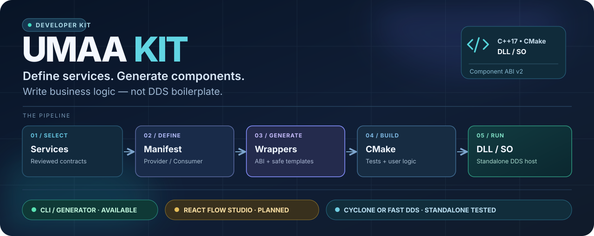
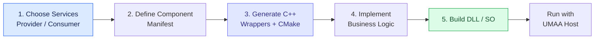
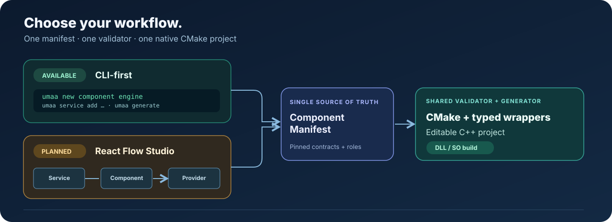
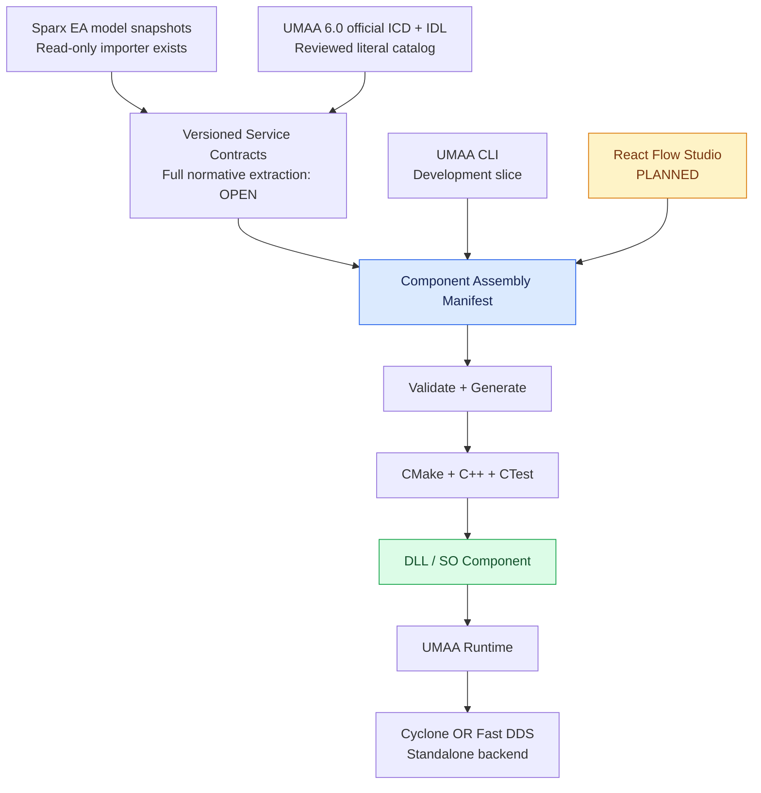
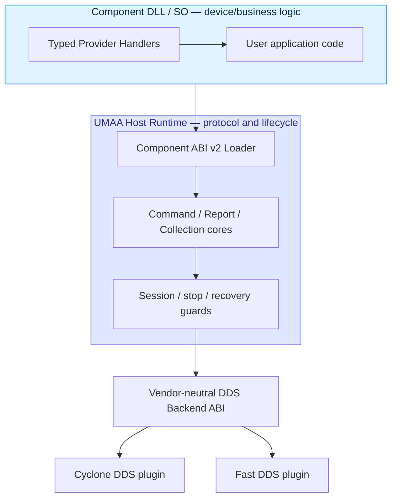
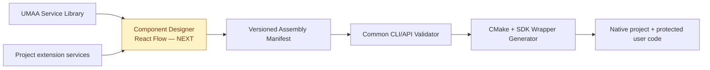
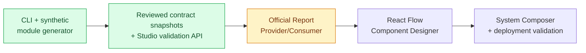

<div align="center">

# UMAA Kit



### **Build native UMAA-aligned components with less plumbing.**

[](https://github.com/rydolabs/umaa-kit/actions/workflows/ci.yml)
[](https://github.com/rydolabs/umaa-kit/actions/workflows/studio-platform.yml)
[](https://github.com/rydolabs/umaa-kit/actions/workflows/verifier.yml)

**A C++ component SDK, code generator, independent DDS testbed, and evolving model-driven development platform.**

**Windows DLL · Linux SO · CMake · Component ABI v2 · Cyclone DDS · Fast DDS**

<sub>Current CLI: synthetic development services only · Official DDS runtime completeness is not claimed</sub>

[Try the Component CLI](#try-the-component-cli) · [Explore the architecture](#how-the-pieces-fit) · [Current capabilities](#what-works-today) · [Studio roadmap](#visual-composition-with-umaa-studio)

</div>

---

## From service definition to native component



UMAA Kit aims to **remove repetitive DDS plumbing from application code**.
Define the services that your component provides or consumes, generate the
project and native module wrappers, then focus on engine control, navigation,
mission logic, device integration or your own algorithms.

The platform separates **a service interface**, **a logical component**, and
**the DLL/SO that implements it**. A component may participate in multiple
services. DDS Topic names, message types, roles and protocol procedures come
from reviewed contracts, not string conventions.

## Two ways to compose. One project format.



**Use the CLI today:** create, validate, generate and build a synthetic ABI-v2
Provider component. **React Flow composition is planned:** the UI will
edit the *same* Component Assembly Manifest, not introduce a separate
generator or invent UMAA wire behavior.



## Try the Component CLI

**The Component generator is on `main` as an early developer preview.**
It emits **buildable synthetic Demo service Provider modules**, not
complete official UMAA 6.0 service bindings.

Run from the repository root with Python 3.10+, CMake 3.20+ and a C++17
compiler:

```bash
# 1. Create a project
python -m tools.umaa_component_cli new component engine_demo

# 2. Compose services
python -m tools.umaa_component_cli service add Demo::EO::EngineControl \
  --role provider --project engine_demo
python -m tools.umaa_component_cli service add Demo::EO::BatteryStatus \
  --role provider --project engine_demo

# 3. Generate the project and user Handler templates
python -m tools.umaa_component_cli generate --project engine_demo

# 4. Install the existing SDK as a CMake package
cmake -S sdk -B build/sdk-cli -DUMAA_BUILD_TESTS=OFF \
  -DCMAKE_INSTALL_PREFIX="$PWD/build/sdk-cli-install"
cmake --build build/sdk-cli --config Release
cmake --install build/sdk-cli --config Release

# 5. Compile and smoke-test the generated native DLL/SO
python -m tools.umaa_component_cli build \
  --project engine_demo --sdk-prefix build/sdk-cli-install
python -m tools.umaa_component_cli test --project engine_demo
```

This is a development example; the generated business handlers initially
**reject Commands** and **throw for Reports**, rather than claim hardware
success. Implement the real behavior in your own Handler files.

```text
engine_demo/
├── umaa.component.json          # common CLI / future Studio manifest
├── CMakeLists.txt               # generated build configuration
├── generated/
│   ├── service_contracts.hpp    # current synthetic test contracts
│   └── component_entry.cpp      # Component ABI v2 export and registration
├── src/handlers/                # YOUR CODE — never overwritten
│   ├── engine_control.hpp
│   └── battery_status.hpp
└── tests/module_smoke.cpp       # actual ABI loader CTest
```

**Regeneration is safe for user-owned files.** Generated files are
explicitly marked; the generator refuses to replace an unmarked CMake file.
The README and user Handlers are never overwritten.

See the [full CLI and generation contract](docs/COMPONENT_PROJECT_GENERATION.md).

### Compose against a pinned Service Contract

The development CLI now also exposes a deterministic, **non-normative**
catalog snapshot and a shared assembly validation gate:

```bash
python -m tools.umaa_component_cli contract export --output build/umaa-contracts.json
python -m tools.umaa_component_cli contract verify --input build/umaa-contracts.json
python -m tools.umaa_component_cli validate --project engine_demo
```

The export retains 53 curated six-ICD service candidates / 113 DDS Topic
identities and their available source references. These are **not 53 completed
native service Runtimes**. Two EO entries still have unknown per-service
provenance, and the generator does not invent it. Official service assemblies
can be source-checked but cannot yet be generated as approved native DDS
Component Runtime modules.

For assemblies using a named public Component Definition, the CLI can also
check the selected Provider/Consumer role against the source-reviewed role
legend (without approving Component membership, QoS or applicability):

```bash
python -m tools.umaa_component_cli validate \
  --project path/to/official_assembly \
  --reference-component 'Autopilot'
```

The official AUVSI Component Definitions v1.0 §3 source check covers **91
published service-role mentions across nine public Component definitions**
(**51 Provider / 40 Consumer**). An explicit `~` means Consumer and no prefix
means Provider. This does not imply any specific acquisition Component
Specification has been selected or that an entire Component is implemented.

**Studio server foundation (available API only):** project-authenticated read-only
Service Contract discovery and stateless Component Assembly validation now
call the **same CLI validation code**. The React Flow canvas and production
build sandbox remain planned, not shipped.

[Service Contract schemas](schemas/) ·
[Studio API status](studio/PLATFORM_V6.md)


## How the pieces fit



The DDS vendor lives **outside application Handler code**. Current
synthetic real-wire tests demonstrate standalone Cyclone DDS and standalone
Fast DDS operation with the **same compiled component/client binaries**
under separate configurations. This does **not** prove that Cyclone and
Fast DDS interoperate with each other on a mixed-vendor network.

## What works today

| Capability | Verified / development status |
|---|---|
| **C++17 SDK + CMake installation** | Built on Linux GCC/Clang and Windows MSVC |
| **Component DLL/SO and ABI v2** | Multi-service registration, load/unload and fail-closed module lifetime tests |
| **Independent Simulator + Verifier** | Scoped cross-process tests and separate verification orchestration |
| **Standalone Cyclone DDS / Fast DDS** | Synthetic real-wire backend tests and same-binary parity |
| **Official UMAA 6.0 IDL** | SHA-pinned official archive (594 IDL source files); compiler-generated genuine TypeSupport is verified in selected Cyclone and Fast DDS tests, **not 594 native service implementations** |
| **Reviewed six-ICD service catalog** | 53 **candidate** services / 113 Topic identities; **not complete normative runtime or QoS** |
| **Public Component role evidence** | Original AUVSI §3 role legend + 91 source-checked mentions (51 Provider / 40 Consumer), **not approved service applicability or Component membership** |
| **Official BatteryStatus Cyclone DDS slice** | SDK-owned typed host List subscription and scoped native Cyclone DDS Reader, real keyed Report/Cell Dispose, independently verified two-source positive/negative wire tests; **not generic official Runtime codegen** |
| **Sparx EA Studio** | Read-only QEA snapshot importer, GUID diff and draft extension IDL; real customer QEA acceptance pending |
| **Component Manifest + CLI + generator** | Available dev preview: synthetic Provider module, CMake and generated CTest |
| **React Flow Component Designer** | **Planned**, not shipped |
| **Full official service bindings / conformance** | **OPEN** — full service-specific Key/QoS/operation contracts, Component applicability, native wire lifecycle and independent normative evidence remain incomplete |

### Official BatteryStatus: what the SDK now owns

The source-reviewed EO BatteryStatus **Cyclone DDS** implementation has two
separate SDK pieces:

- `sdk/include/umaa/official_battery_subscription.hpp` owns the bounded
  two-Topic Large List host state machine and delivers completed per-source
  snapshots to a typed `BatteryStatusHandler`. It invalidates incomplete
  updates and fences stale callbacks with reader epochs.
- `dds-backends/cyclone/include/umaa/cyclone_official_battery_reader.hpp`
  owns the narrow original Cyclone DDS Participant/Subscriber/DataReaders,
  decodes compiler-generated native Report and Cell types, checks effective
  `TOPIC` + ordered Presentation on its local Subscriber, and resolves
  genuine instance-keyed DDS Dispose events. Application business callbacks
  need no DDS calls.

A standalone publisher and business-only consumer exercised two independent
Battery Sources, four Cell instances, six true keyed Dispose notifications,
and a deliberately invalid second-list checkpoint. **7/7 original-IDL native
CTests passed** at [PR #62's exact code snapshot](https://github.com/rydolabs/umaa-kit/actions/runs/41933577012);
the [Linux/Windows Handler host tests](https://github.com/rydolabs/umaa-kit/actions/runs/41931272014)
also passed.

This is **a manually source-reviewed integration slice**, not a usable
all-service native Runtime generator or a published fully normative
BatteryStatus Component. Official source files and generated native
TypeSupport are acquired/built in temporary CI workspaces, not committed or
redistributed in this repository. The full official Runtime code-generation
gate remains **fail-closed**.

See [Battery native Reader evidence](docs/OFFICIAL_BATTERY_NATIVE_CYCLONE_WIRE.md),
[Battery List and Handler semantics](docs/OFFICIAL_BATTERY_LARGE_LIST_JOINER.md)
and [official Runtime acceptance requirements](docs/OFFICIAL_NATIVE_RUNTIME_EVIDENCE_GATE.md).

### Genuine safety boundaries matter

- **UMAA service identity does not equal a verified service implementation.**
  The new generator refuses official service DLL/SO bindings until their
  TypeSupport, key, role, QoS and required runtime semantics are reviewed.
- **No invented Query RPC.** UMAA queryless Request/Reply is implemented
  through Report subscription where the ICD prescribes that behavior.
- **No invented hardware success.** A real Command's completion and
  cancellation safety must come from the actual device business logic.
- **No implied formal UMAA / K-MOSA compliance.** Synthetic DDS tests,
  model drafts and ABI smoke tests cannot substitute for normative tests.
- **Current scope is independent standalone vendors.** Mixed Cyclone↔Fast DDS
  network interoperability remains a later objective, with historical strict
  failure evidence preserved. Licensed RTI Connext independent validation
  is also deferred and **NOT VERIFIED**.

[Current milestone scope](docs/CURRENT_PHASE_SCOPE.md) ·
[Delivery gates](docs/DELIVERY_GATES.md) ·
[Implementation and evidence history](docs/README_IMPLEMENTATION_HISTORY_2026-10-30.md)

## Visual composition with UMAA Studio



The **planned** visual editor will offer a service library, Component canvas,
Provider/Consumer role ports, validation details and project generation.
A diagram is only an editor representation: **the Manifest is the source of
truth for assembly**, and generated code uses reviewed Service Contracts.
Sparx EA remains the proposed source for K-UMAA modeled specifications,
not a second place to hand-edit official UMAA contracts.

[Studio V6 documentation](studio/PLATFORM_V6.md) ·
[Component project design and acceptance stages](docs/COMPONENT_PROJECT_GENERATION.md)

## Repository map

| Area | Purpose |
|---|---|
| [sdk/](sdk/) | Typed SDK, Component ABI v2, Command/Report/Collection runtime and CMake |
| [dds-backends/](dds-backends/) | Standalone Cyclone/Fast DDS backend plugins and selected vendor-native adapters |
| [dds/](dds/) | Real DDS integration and source-scoped official wire examples |
| [studio/](studio/) | QEA importer, versioned model workspace, draft IDL and web foundation |
| [simulator/](simulator/) | Independent simulator and cross-process assertions |
| [verifier/](verifier/) | Independent scoped verification CLI/orchestration |
| [catalog/](catalog/) | Reviewed UMAA service and Topic contracts |
| [tools/](tools/) | Official source validators, IDL/registry generators, new Component CLI |
| [docs/](docs/) | Architecture, evidence, acceptance gates and technical backlog |

## What's next



Our goal: **use the CLI like a native build tool, or design visually in
Studio — and receive the very same editable, buildable CMake project.**

**Remaining engineering work:** turn source-reviewed service candidates into
approved **per-service** Topic/Key/QoS and operation contracts; complete
the official BatteryStatus Provider/Consumer lifecycle and automated Component
binding beyond the Cyclone-only manual slice; extend the same pattern to full
EngineControl Command/Ack/Status/Update/Cancel and further services; then
verify per-vendor QoS, genuine multiwriter Collection coherency, reconnect
replay and independent normative conformance. Native Fast DDS ordered
`TOPIC` Presentation is currently unsupported for the official Battery
Large Collection requirement. A production release also needs security,
resource/long-duration fault testing and any applicable acceptance review.
Mixed Cyclone↔Fast networks and RTI Connext remain **later milestones**
rather than current-phase release criteria.

The active [milestone boundary](docs/CURRENT_PHASE_SCOPE.md) and
[delivery gates](docs/DELIVERY_GATES.md) distinguish these obligations from
the synthetic and narrow official tests already passing.

Track ongoing scope and verified evidence in the
[implementation issue](https://github.com/rydolabs/umaa-kit/issues/2),
[SDK architecture](docs/SDK_MODULAR_ARCHITECTURE.md),
[official ICD catalog audit](docs/specification/ICD_CATALOG_AUDIT.md)
and [GitHub Actions](https://github.com/rydolabs/umaa-kit/actions).
