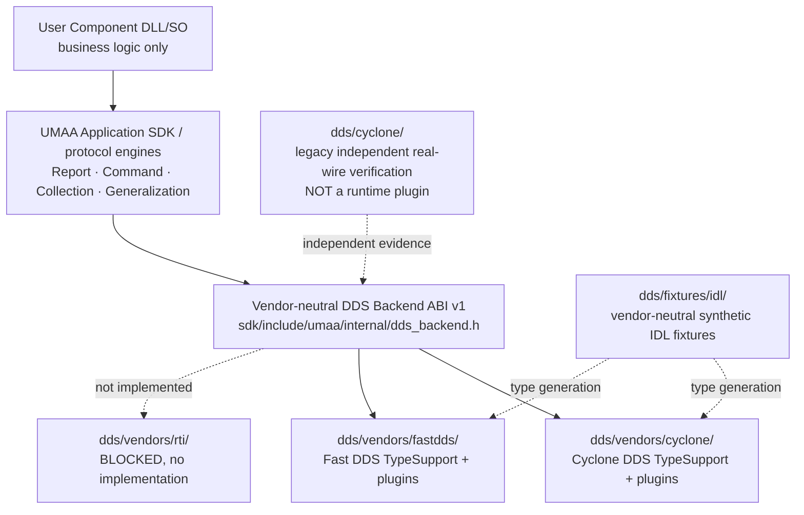

# DDS layout — one canonical SDK backend implementation path

**2026-10-30 development scope.** UMAA Kit is inspired by the architectural
separation of ROS 2's `rcl / rmw / rosidl_typesupport_*`, but it **does not
depend on ROS 2** or claim to implement the ROS `rmw` API.



## Current directories

| Location | What belongs here | What must not be added |
| --- | --- | --- |
| `sdk/include/umaa/` | Vendor-neutral component API, Report/Command/Collection/Generalization FSM, loading/callback lifecycle | Native Cyclone/Fast DDS headers |
| `sdk/include/umaa/internal/dds_backend.h` | **One versioned C ABI**, checked entrypoint and required capabilities | Service-specific vendor serialization |
| `dds/vendors/common/` | Shared synthetic binding allow-list and conformance helper code, with no vendor headers | Invented official QoS/Key/IDL guesses |
| `dds/vendors/cyclone/` | **Canonical** Cyclone backend plugin code and Cyclone-native generated TypeSupport | Application business code |
| `dds/vendors/fastdds/` | **Canonical** Fast DDS backend plugin code and Fast DDS-native generated TypeSupport | Application business code |
| `dds/vendors/rti/` | Clear BLOCKED status pending licensed SDK and real tests | A fake RTI plugin with claimed support |
| `dds/fixtures/idl/` | Shared synthetic IDL test fixtures used by **both** vendor builds | Official AUVSI IDL redistributed into repo |
| `dds/cyclone/` | **Existing independent verification harness** for Cyclone and selected official TypeSupport tests | New runtime backend plugin implementations |

The apparent duplicate `dds/cyclone/` and `dds/vendors/cyclone/` is a
**test-vs-runtime split**. The former contains historical proof applications
and independent Simulator tests; the latter is the sole canonical Cyclone SDK
backend implementation. We moved their shared sample IDL out to
`dds/fixtures/idl/` so the Fast DDS build no longer depends on a sibling
vendor's directory. The historical proof harness is retained (not silently
deleted or moved) until all external build and evidence links can be migrated
with the independent official-IDL regression suite.

## What stays common versus what changes per vendor

```text
User Component                → vendor independent
Service Contract / approved QoS and Key → vendor independent, source-pinned
UMAA Report/Command/Collection FSM     → vendor independent
UmaaDdsBackendV1              → vendor independent, ABI versioned
TypeBinding allow-list        → shared contract, exact topic/schema/QoS
Native Reader/Writer/Participant       → vendor-specific
Generated TypeSupport adapter          → vendor-specific
DDS QoS mapping + instance handles     → vendor-specific
Independent wire tests                 → per vendor, common assertions
```

Currently the synthetic Battery Report, Command and Collection examples are
**three separate plugin modules per vendor**. They implement the same C ABI,
but a single currently built plugin **does not** yet host all three type
families at once. The **target after verified official bindings** is one
logical vendor plugin per selected DDS implementation with an explicit
per-service TypeBinding registry (not one DLL per Topic). Do **not** merge
unrelated native samples into one plugin without lifecycle/TypeSupport tests.

## Backend onboarding and rules

Every vendor has `dds/vendors/<name>/backend.json` that declares:

- an exact `UmaaDdsBackendV1` version and entrypoint;
- the vendor and implementation status (synthetic-development / blocked);
- only capability flags actually evidenced by real independent-process tests;
- each synthetic example source and its shared IDL fixture;
- explicit `normativeUmaaWireVerified: false`.

The **Python architecture guard** and **C++ native TypeBinding contract
test** check the manifest, source locations, both vendor adapters' shared
Topic/Schema/QoS filters, cross-family confusion and unsupported capability
rejection. This catches source-tree drift **before vendor middleware tests**.
See [Adding a backend](vendors/ADDING_A_BACKEND.md).

A running Host still checks the **actual dynamically loaded ABI function
table**, version, struct size and capabilities. Manifest metadata alone
does not assert a plugin was installed or an official service was validated.

## Required acceptance evidence

1. Build both vendor adapters independently with their actual Cyclone/Fast
   DDS SDK and generated TypeSupport.
2. Run identical SDK client and Component binaries against each backend in
   separate single-vendor environments; use a distinct process for the
   Provider and Consumer. Verify data, ACK, key, Dispose, error and unload.
3. Reject unsupported QoS (especially native coherent GROUP / ordered
   Collection) rather than silently substitute a single-sample fallback.
4. Official service binding requires original ICD+IDL, exact Key, DDS QoS,
   Source/Participant identity, TypeSupport and an independently verified
   cross-process Provider/Consumer.
5. Keep the **mixed Cyclone↔Fast DDS network trial** separate and deferred;
   historical strict failure is not a success. Licensed RTI independent
   validation is likewise **NOT VERIFIED**.

This structure is an SDK architecture constraint, not official UMAA 6.0
conformance.
